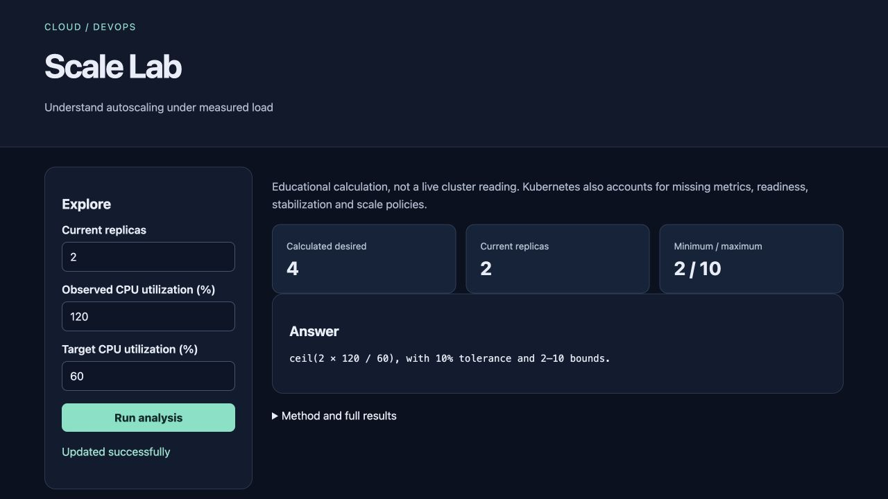

# Scale Lab

Understand autoscaling under measured load for **platform engineering learners**.

Cloud/DevOps topic selected with explicit user authorization after source verification; it is not attributed to an unseen Instagram slide.

> Local portfolio implementation developed with Codex assistance. Measured results and limitations are documented; no production adoption, revenue or hiring outcome is claimed.



## What works

- Kubernetes deployment
- HPA
- probes
- CPU load
- kind CI

[Example output](reports/example-output.json) · [Recorded checks](reports/test-results.txt) · [Learning and interview guide](LEARNING_GUIDE.md)

## Start

Python 3.12 is the validated Python runtime. Run commands from this repository directory. Windows users activate `.venv\Scripts\activate` instead of `source`.

```sh
python3.12 -m venv .venv
source .venv/bin/activate
python -m pip install -r requirements.txt
python app.py
```

Open **http://127.0.0.1:8080**. Keep the process running. Set `PORT` to use another port. The Python development servers are intended for local demonstrations.

## Demonstration

Inspect the HPA calculation locally, then follow the kind workflow to build/load the worker image, apply the manifests, start load, and observe more than two replicas. Review recorded CI evidence.

## Architecture and decisions

Browser controls → validated Flask API → project analysis/workflow → results and export.

Stack: Kubernetes · kind · Python.

1. Set CPU requests so utilization-based HPA has a valid denominator.
2. Separate a transparent calculation model from actual Kubernetes manifests and cluster observations.
3. Run an ephemeral kind cluster, Metrics Server and a real load workload in CI to observe replica growth.

## Verification

```sh
python -m pytest -q
```

See [VERIFICATION.md](VERIFICATION.md) for actual executed checks, setup verification, model/data results and any outstanding environment limitations. The [recorded CI runs](reports/ci-verification.json) passed for the linked source revision.

## Data and attribution

Ephemeral local/CI cluster. See [DATA_AND_SOURCES.md](DATA_AND_SOURCES.md) for provenance and usage notes. Original project code is MIT unless a preserved source file or dependency states otherwise. Model and third-party data licenses remain separate.

## Limitations and next improvement

The calculator omits some Kubernetes controller details. Real validation uses a temporary single-node kind cluster, not a production cluster. The kubelet insecure-TLS flag is restricted to that disposable local cluster. Scale-down duration, node autoscaling and cloud costs are not benchmarked.

Suggested extension: Change CPU requests and explain why the same absolute CPU consumption produces a different utilization percentage.

## Honest portfolio use

This implementation and documentation were developed with substantial Codex assistance. Before presenting it, run the demonstration, explain the design choices, and complete the suggested independent modification. Do not describe generated code as work experience, an accepted upstream contribution, or a deployed production service.

## Reproduce the cluster experiment

Install Docker, kind and kubectl first. The [CI workflow](.github/workflows/test.yml) is the verified full sequence. A local cluster uses your machine, not a paid cloud account:

```sh
kind create cluster --name scale-lab
docker build -t scale-lab:local .
kind load docker-image scale-lab:local --name scale-lab
kubectl --context kind-scale-lab apply -f https://github.com/kubernetes-sigs/metrics-server/releases/download/v0.7.2/components.yaml
kubectl --context kind-scale-lab patch deployment metrics-server -n kube-system --type=json -p='[{"op":"add","path":"/spec/template/spec/containers/0/args/-","value":"--kubelet-insecure-tls"}]'
kubectl --context kind-scale-lab rollout status deployment/metrics-server -n kube-system --timeout=180s
kubectl --context kind-scale-lab apply -f k8s.yaml
kubectl --context kind-scale-lab rollout status deployment/scale-lab --timeout=120s
kubectl --context kind-scale-lab run load --image=busybox:1.36 --restart=Never -- /bin/sh -c 'for i in 1 2 3 4 5 6 7 8; do while true; do wget -q -O- http://scale-lab/work; done & done; wait'
kubectl --context kind-scale-lab get hpa,pods,deployments -w
# After finishing, remove this disposable test cluster:
kind delete cluster --name scale-lab
```

The kubelet TLS exception is only for this disposable kind experiment. The saved first CI observation is [two to six available replicas](reports/hpa-evidence.txt).
